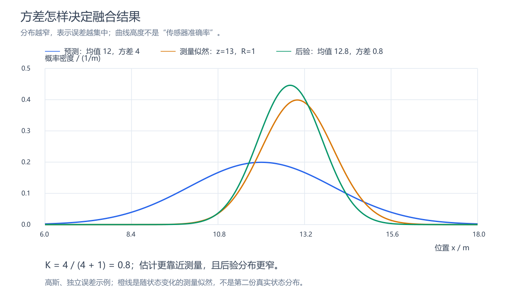

# 嵌入式卡尔曼滤波入门

从传感器噪声、模型预测与方差融合出发，理解卡尔曼滤波如何用于嵌入式状态估计，并以 IMU 倾角融合为主要案例。

## 阅读顺序

1. [原理文章：从传感器噪声到 IMU 姿态融合](卡尔曼滤波入门：从传感器噪声到IMU姿态融合.md)
2. [实用程序例程与开源案例](卡尔曼滤波实用例程与开源案例.md)
3. [学习讨论总结](聊天总结：卡尔曼滤波与嵌入式IMU应用.md)

内容包括预测与修正、卡尔曼增益、Q/R/P 参数、一维 C 例程、陀螺仪零偏估计、航向漂移、磁力计与 DMP 的区别，以及开源代码阅读入口。

## 配图



[images](images) 中提供四组 PNG/SVG 图片，以及连续温度模拟数据 [CSV](images/temperature-simulation.csv)。图片属于教学模拟，不是硬件测试结果。

## 复现配图

使用已有 Node.js 环境，在仓库根目录运行：

```sh
node images/generate.cjs
```

脚本无额外依赖即可生成 SVG 和 CSV；只有环境中可解析到 `sharp` 包时才生成 PNG。没有 Sharp 时会输出说明，仓库已经附带可直接阅读的 PNG，无需为阅读安装工具。

## 验证状态

已核对文章所引用的关键开源接口，复算示例数值，并生成、查看配图。自编 C 示例尚未完成编译和硬件验证；具体设备的坐标、量程、采样时间与噪声参数需要单独确认。引用项目遵循各自许可证，本仓库没有复制其完整实现。
