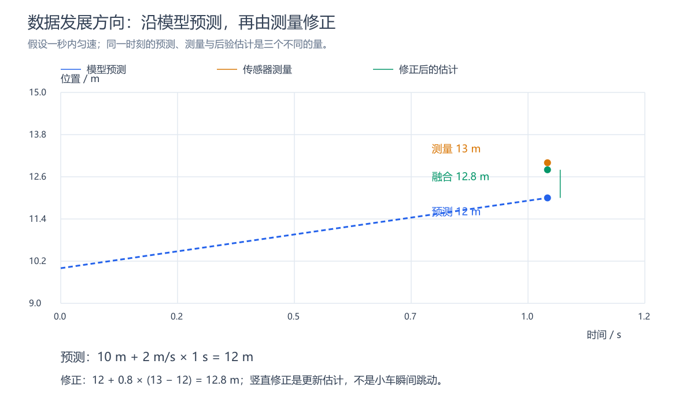
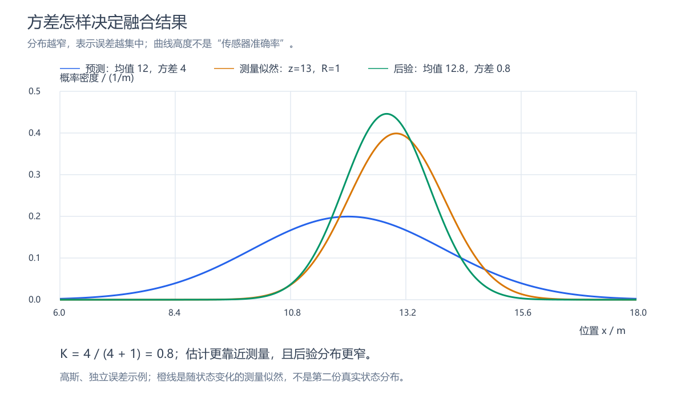
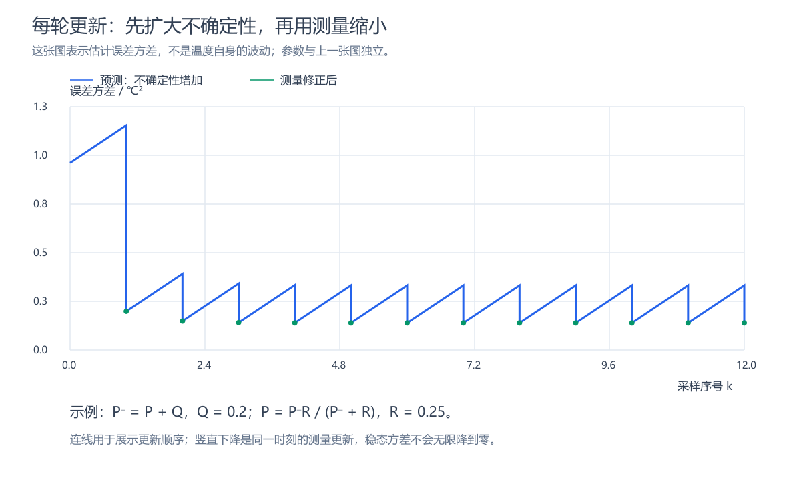
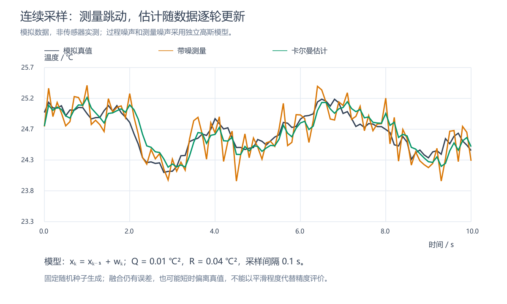

# 卡尔曼滤波入门：从传感器噪声到 IMU 姿态融合

配套阅读：[实用程序例程与开源案例](卡尔曼滤波实用例程与开源案例.md)，包含一维温度滤波 C 程序、MPU6050 参数传入方式，以及可核对的开源实现链接。

单片机读到了传感器数据，为什么还不能直接拿来控制？

把一块 IMU 放在桌面上，陀螺仪的读数通常不会恰好为零；根据加速度计计算出的倾角也会轻微跳动。设备真正运动起来后，问题更复杂：有些读数变化来自真实运动，有些来自噪声，有些则来自温度变化、零偏和振动。

控制器需要知道的是设备现在处于什么状态，而传感器提供的是关于状态的、有误差的观测。卡尔曼滤波就处在这两者之间：**根据模型预测状态，再利用测量修正预测，同时维护对估计误差的判断。**

为什么不能直接取平均？预测凭什么有用？两种传感器意见不一致时，该相信谁？这篇沿着这些问题，从一个数的估计走到 IMU 的倾角融合，再说明在嵌入式里怎样使用，以及它解决不了什么。

## 一、先分清测量、估计与控制

以电机速度控制为例，编码器提供位置计数，估计器根据连续计数和运动模型估计速度，速度控制器再根据目标与实际速度的差，决定需要多大驱动力。

```text
编码器测量 → 状态估计 → 速度控制器 → 电机驱动
                  ↑                       │
                  └──── 实际运动反馈 ──────┘
```

卡尔曼滤波可以承担状态估计这一步。它不会直接决定电机应该产生多大转矩，也不会自动让设备保持平衡；这些是控制算法要解决的问题。

这里的“状态”，是描述系统当前情况、并用于预测后续变化的一组变量。例如温度估计可以只有温度，运动估计可以包含位置和速度，姿态估计还可能包含陀螺仪零偏。

**滤波器输出平稳，只说明变化小，不能单凭这一点判断它准确。** 一个始终输出零的程序也很平稳，但它显然不能跟踪运动。

## 二、为什么平均滤波还不够

假设温度传感器连续读出：

```text
25.1、24.8、25.3、24.9、25.2 ℃
```

如果真实温度基本不变，取平均往往有效。但如果温度正在快速上升，较早的低温读数会拖住结果，形成延迟。

电机速度估计还有另一个问题：位置差除以时间间隔就能得到平均速度，但位置量化误差会进入差分结果。采样周期很短时，少量计数差异也可能表现为明显的速度跳动。

这些问题提示我们：除了处理读数，还可以利用“系统怎样变化”的知识。知道电机上一刻的位置和速度，就能预测下一刻的位置；知道板子正在以多大角速度转动，就能预测下一刻的倾角。

预测也会错，但它提供了一条与当前测量不同的信息来源。

## 三、先预测，再修正：卡尔曼滤波究竟干了什么

假设上一秒估计小车位于 10 m，速度为 2 m/s。采用匀速模型，一秒后的预测位置为：

$$
\hat{x}^-=10+2\times1=12\ \mathrm{m}
$$

传感器却测到 13 m。不能只因为测量更新了，就认定 13 m 一定正确；也不能因为模型算出了 12 m，就忽略测量。

一种自然的修正方式是：

$$
\boxed{\hat{x}=\hat{x}^-+K(z-\hat{x}^-)}
$$

其中，$\hat{x}^-$ 是修正前的预测，$z$ 是测量，$\hat{x}$ 是修正后的估计。帽子表示估计值，上标负号表示“尚未用本次测量修正”，不是数值为负。

$z-\hat{x}^-$ 叫作残差，表示测量与预测差多少；$K$ 是卡尔曼增益，决定用多少残差来修正预测。

若 $K=0.8$，结果为 12.8 m；若 $K=0.2$，结果为 12.2 m。问题因此变成：**这一轮的权重应该是多少？**



图：蓝色虚线根据位置和速度预测后续位置，绿色点是在测量到达后得到的新估计。绿色修正发生在估计层面，不是小车在同一时刻发生位移跳变。

## 四、权重来自不确定性

只知道“预测是 12 m、测量是 13 m”还不够，还要知道两者通常能错多少。

用方差描述误差大小：预测误差方差记为 $P^-$，测量噪声方差记为 $R$。在测量直接对应状态、预测误差与测量噪声不相关的单变量情况下：

$$
K=\frac{P^-}{P^-+R}
$$

例如，预测误差标准差为 2 m，测量误差标准差为 1 m，则：

$$
P^-=4\ \mathrm{m^2},\qquad R=1\ \mathrm{m^2},\qquad K=0.8
$$

预测更不确定，所以结果更靠近测量。修正后的误差方差为：

$$
P=(1-K)P^-=0.8\ \mathrm{m^2}
$$



图：在独立高斯误差假设下，蓝线是预测分布，橙线是给定本次测量后随状态变化的似然，绿线是两者相乘并归一化后的后验分布。测量更精确，后验均值就更靠近测量；后验方差从 4 降至 0.8。这里展示的是分布相乘，不是把两条曲线逐点取平均。

注意，$P$ 描述的是**估计可能错多少**，不是小车运动范围有多大。它由模型和噪声假设计算得到，也不是对当前真实误差的直接测量。

在上述不相关误差假设下，也能从数学上看出权重的来源。加权估计的误差方差为：

$$
J(K)=(1-K)^2P^-+K^2R
$$

对 $K$ 求导并令其为零，就得到前面的增益公式。选择这个权重，是为了让误差方差最小，而不是为了让曲线看起来最平。

## 五、一维滤波怎样连续运行

先考虑一个缓慢变化的量，用“下一时刻基本等于当前时刻”的模型描述它：

$$
x_k=x_{k-1}+w_k,\qquad z_k=x_k+v_k
$$

$w_k$ 表示模型没有预测到的变化，方差为 $Q$；$v_k$ 表示测量噪声，方差为 $R$。下标 $k$ 表示第 $k$ 次采样。

每一轮执行下面五个计算：

| 步骤 | 公式 | 含义 |
| --- | --- | --- |
| 预测状态 | $\hat{x}_k^-=\hat{x}_{k-1}$ | 暂时沿用上一轮估计 |
| 预测误差 | $P_k^-=P_{k-1}+Q$ | 没有新测量时，不确定性增加 |
| 计算增益 | $K_k=P_k^-/(P_k^-+R)$ | 根据双方不确定性分配权重 |
| 修正状态 | $\hat{x}_k=\hat{x}_k^-+K_k(z_k-\hat{x}_k^-)$ | 用测量修正预测 |
| 更新误差 | $P_k=(1-K_k)P_k^-$ | 记录修正后的不确定性 |

下一轮只需保留 $\hat{x}_k$ 和 $P_k$，不必保存全部历史测量，这就是递推计算。



图：预测先加入过程噪声，使不确定性增加；新测量再使方差降低。持续存在过程噪声时，方差通常收敛到非零水平，不会因为采样次数多就无限接近零。这张图采用单独的示例参数。



图：模拟缓慢变化的温度，叠加测量噪声后逐轮滤波。绿色估计通常比橙色测量平稳，但仍会与真值存在差异。数据按固定随机种子生成，属于教学模拟，不代表某款传感器的精度；采样数据见 [CSV](images/temperature-simulation.csv)，配图可由 [生成脚本](images/generate.cjs)复现。

对这个固定采样周期的模型，增大 $Q$ 通常会让估计更快跟随测量；增大 $R$ 通常会让估计更平缓、响应更慢。但 $Q$、$R$ 首先是统计模型参数，不应只被当成“平滑旋钮”。

这个模型没有速度或加速度概念。直接拿它处理快速运动，再不断调参数，效果仍可能不理想；有时应当修改模型，而不是继续调权重。

## 六、换成 IMU：为什么要融合陀螺仪与加速度计

六轴 IMU 通常包含三轴陀螺仪和三轴加速度计。先只研究板子绕水平 $x$ 轴的单轴转动，避免一开始就进入完整三维旋转。

### 1. 陀螺仪：知道角度怎样变化

陀螺仪测量角速度。当前倾角为 $10^\circ$，角速度为 $20^\circ/\mathrm{s}$，经过 0.01 s 后：

$$
\theta^-=10+20\times0.01=10.2^\circ
$$

它适合跟踪快速转动，但积分会积累误差。例如静止时存在 $0.1^\circ/\mathrm{s}$ 的恒定零偏，一分钟就能积累约 $6^\circ$ 的角度误差。

### 2. 加速度计：提供重力方向参考

加速度计测量比力，并不直接输出角度。在静止或运动加速度较小的条件下，其读数主要反映重力相关的轴向分量，可以用来计算倾角。

例如，在本文选定的轴向与符号约定下，水平时 $a_z$ 为正，绕 $x$ 轴正向倾斜时 $a_y$ 为正，则可写为：

$$
\theta_{\mathrm{acc}}=\operatorname{atan2}(a_y,a_z)
$$

这不是可以忽略坐标约定直接复制的公式。安装方向、轴的正负和角度定义改变，表达式也要相应改变。利用三轴加速度计求倾角的几何关系及运动加速度影响，可参考 [NXP AN3461](https://www.nxp.com.cn/docs/en/application-note/AN3461.pdf)。

它不需要积分，所以不会积累同样的积分漂移；但设备平移加速或振动时，倾角计算会受到干扰。两种传感器由此形成互补：一个善于跟踪短时变化，一个在条件合适时提供长期参考。

## 七、把倾角和陀螺仪零偏一起估计

如果只修正倾角，下一轮仍然用带偏差的角速度积分，漂移会继续产生。因此，可以把零偏也放入状态：

$$
\mathbf{x}=\begin{bmatrix}\theta\\b\end{bmatrix}
$$

$b$ 是陀螺仪零偏，单位为角速度。测量角速度记为 $\omega_m$，预测时先减去零偏：

$$
\theta_k^-=\theta_{k-1}+(\omega_{m,k}-b_{k-1})\Delta t
$$

$$
b_k^-=b_{k-1}
$$

第二式是假设短时间内零偏基本不变；真实零偏缓慢变化的部分通过过程噪声描述。

然后利用加速度计倾角计算残差：

$$
r_k=\theta_{\mathrm{acc},k}-\theta_k^-
$$

同时修正倾角和零偏：

$$
\theta_k=\theta_k^-+K_\theta r_k,\qquad
b_k=b_k^-+K_b r_k
$$

两个增益来自协方差计算，符号和大小由模型决定。它们不能简单理解成两个都在 0 到 1 之间的平均系数。

为什么角度残差还能修正零偏？因为预测公式里，零偏会影响后续角度。这个关系使两者的估计误差产生关联：如果加速度计持续显示板子没有倾斜，而积分角度不断偏离，滤波器就有依据调整零偏估计。一次残差并不能证明零偏是多少，修正要在连续测量和模型约束下进行。

## 八、矩阵公式只是把这些关系写在一起

前面的双状态预测可写为：

$$
\mathbf{x}_k^-=F\mathbf{x}_{k-1}+B\omega_{m,k}
$$

$$
F=\begin{bmatrix}1&-\Delta t\\0&1\end{bmatrix},\qquad
B=\begin{bmatrix}\Delta t\\0\end{bmatrix},\qquad
H=\begin{bmatrix}1&0\end{bmatrix}
$$

$F$ 描述状态如何演化，$B$ 表示角速度怎样参与预测，$H$ 表示加速度计提供的是倾角观测，没有直接测量零偏。

协方差与增益按下面的关系更新：

$$
P_k^-=FP_{k-1}F^T+Q
$$

$$
S_k=HP_k^-H^T+R,\qquad K_k=P_k^-H^TS_k^{-1}
$$

$$
\mathbf{x}_k=\mathbf{x}_k^-+K_k(z_k-H\mathbf{x}_k^-)
$$

$$
P_k=(I-K_kH)P_k^-
$$

$P$ 从一个方差变成了矩阵：对角线描述各状态的误差方差，非对角线描述误差之间的关联。这里的 $Q$ 也已经是过程噪声协方差矩阵，各元素单位不一定相同。陀螺仪测量噪声经积分传播产生的影响也应计入预测不确定性。

本例只有一个角度测量，因此 $S_k$ 是标量，不需要编写通用矩阵求逆程序。标准递推关系可核对 [Welch 与 Bishop 的卡尔曼滤波入门](https://www.cs.unc.edu/~welch/media/pdf/kalman_intro.pdf)。

这个单轴模型用于理解和受限运动；加速度计角度噪声只是近似按所设模型处理。完整三维旋转具有非线性，不能把三轴角速度分别积分就当成三个欧拉角，常使用四元数配合扩展卡尔曼滤波或误差状态滤波。

## 九、为什么它修不了所有航向漂移

把 IMU 水平放好，再保持水平旋转。它朝北、朝东、朝南时，重力在传感器坐标中的投影基本不变。因此，加速度计无法判断设备绕重力方向转了多少，也就不能单独纠正这个方向的角度漂移。

当设备 Z 轴竖直时，这正是常说的航向角漂移。沿 Z 轴上下移动则是另一个问题，不要把位移与绕轴旋转混在一起。

要长期约束航向，需要额外参考，例如磁力计、双天线 GNSS，或带有相应方向约束的视觉与外部定位系统。磁力计可提供地磁方向，但靠近电机、磁铁和大电流导线时，读数可能失真，还需要校准和异常判断。

**六轴 IMU 加磁力计是常见的九轴融合方案，但传感器数量并不等于可靠性。** 在磁环境恶劣的设备里，错误的磁航向可能比短时陀螺仪漂移更糟。

这里涉及一个重要概念：可观测性，即能否通过测量和模型区分不同状态。如果两个不同朝向产生相同测量，滤波器就无法仅凭这些数据判断哪一个是真的。换算法不能凭空增加信息。

## 十、互补滤波、DMP 和卡尔曼滤波是什么关系

常见的单轴互补滤波可以写成：

$$
\theta_k=\alpha\left(\theta_{k-1}+\omega_k\Delta t\right)
+(1-\alpha)\theta_{\mathrm{acc},k}
$$

它用固定权重结合陀螺仪积分与加速度计角度，结构简单、计算量小。卡尔曼滤波则通过误差协方差计算增益，并能按模型同时估计零偏等状态。

不过，卡尔曼增益并不一定一直变化：在固定模型、固定噪声和固定采样周期下，它可能逐渐收敛。因此，区别不只是“固定权重”和“变化权重”，还包括状态模型与不确定性的处理方式。

DMP 则属于另一个层面：它是部分 IMU 内部用于运动数据处理的引擎。它运行什么算法、能输出什么，取决于具体芯片和固件，不能仅凭 DMP 这个名称认定内部使用卡尔曼滤波。

## 十一、在单片机上落地，先处理哪些事情

首先处理时间和坐标。使用采样时间戳计算 $\Delta t$，避免把循环执行间隔误当成传感器采样间隔；若通过 FIFO 批量读取数据，也不能把总读取间隔套在每一个样本上。角度统一使用弧度或度，角速度单位保持对应，并确认不同传感器的轴向一致。

接着处理初始化。静止时可以用加速度计估计初始倾角，用一段陀螺仪数据的平均值估计初始零偏。初始 $P$ 表达你对这些初值的信任程度；把它设成零，相当于宣称初值完全准确，通常缺少依据。

再处理噪声参数。静止数据的样本方差可以帮助初步估计测量噪声，但不能代表设备运动时的所有误差。$Q$ 需要结合角速度噪声、零偏变化和采样周期构建；改变采样频率后，应重新核对离散噪声模型。

最后处理不可信测量。加速度模长明显偏离 $g$ 时，可以降低加速度计权重或暂停修正。但模长接近 $g$ 并不能证明方向准确，持续加速仍可能造成误判。角度跨越 $-\pi/\pi$ 时也要对残差做环绕处理，避免把 $179^\circ$ 与 $-179^\circ$ 当成相差 $358^\circ$。

浮点计算中，应关注协方差的对称性与数值稳定性。必要时采用 Joseph 形式更新：

$$
P=(I-KH)P^-(I-KH)^T+KRK^T
$$

单变量或双状态算法通常适合 MCU 实现；是否满足实时要求，仍要在目标芯片、编译选项和任务周期下测量。本文给出的是估计模型和计算关系，不是已经完成硬件验证的姿态库。

## 十二、怎样判断它真的有效

至少要观察三类工况：静止时的抖动与漂移，真实转动时的跟随误差与延迟，以及平移加速、振动或磁干扰时是否被错误修正。

记录原始角速度、加速度计倾角、融合角度、零偏估计和残差，再与独立参考比较。只把融合结果与参与融合的加速度计角度比较，不能充分证明准确性。没有独立参考时，可以检查静止漂移和重复性，但不应据此宣称完整动态精度。

如果算法用于闭环控制，还要观察估计延迟对控制响应的影响。离线曲线更平滑，不自动代表闭环表现更好。

## 十三、“数学上最优”应该怎样理解

这里的最优通常以均方误差为标准，而不是曲线平滑程度、最小计算量或每一次误差最小。

在线性模型、正确的初始统计量与噪声协方差，以及相应白噪声和不相关条件下，卡尔曼滤波给出最小均方误差的线性估计。进一步满足联合高斯条件时，它等于给定已有测量后的条件均值，在所有使用同样信息的估计方法中达到最小均方误差。这些条件和递推推导可参考 [Welch 与 Bishop](https://www.cs.unc.edu/~welch/media/pdf/kalman_intro.pdf)。

模型不符、噪声参数错误、固定偏差未建模或出现异常尖峰时，最优性保证不能直接照搬。扩展卡尔曼滤波采用局部线性化，也没有普遍的全局最优保证。

在嵌入式系统中，选择卡尔曼滤波的理由应当是：系统确实有可利用的模型，测量能约束所需状态，并且硬件算力与调试条件允许维护这套估计。对简单的读数平滑，均值或低通滤波可能已经合适；对位置与速度估计、IMU 融合和多源定位，模型与测量的结合才更能发挥价值。
