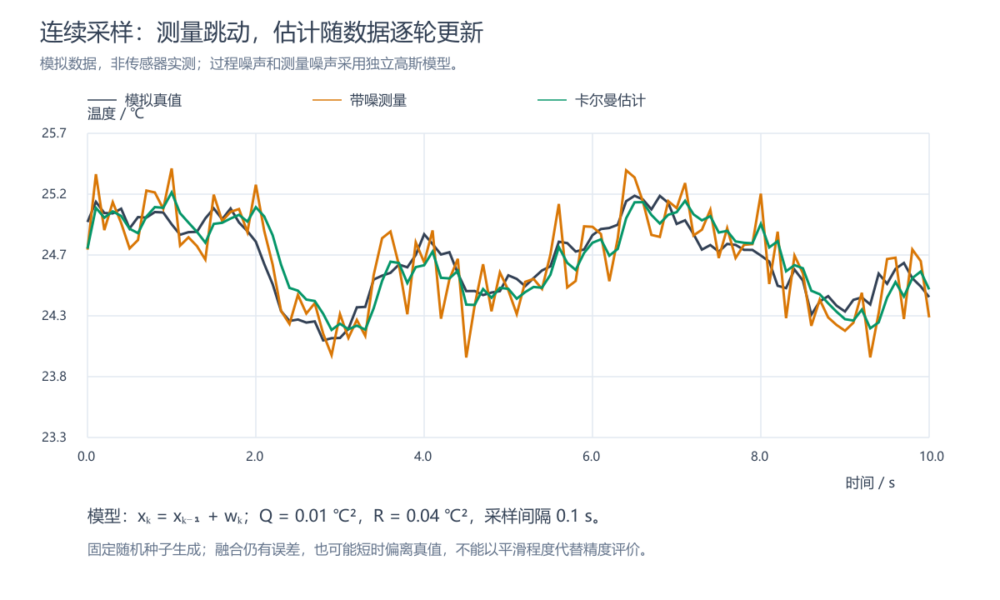

# 卡尔曼滤波实用例程与开源案例

本文配合《卡尔曼滤波入门：从传感器噪声到 IMU 姿态融合》阅读。以下先给出可独立理解的一维 C 示例，再对照网上的 IMU 源码，说明每个输入从哪里来。链接和源码于 2026-11-01 核对；代码阅读不等于目标硬件验证。

## 一、温度滤波：每获得一个新读数，调用一次

下面是本文自行编写的标准标量随机游走模型示例，不是从后面的开源库摘录。假设每 100 ms 获得一个温度值。

```c
#include <stdio.h>

typedef struct {
    float x;  /* 温度估计，摄氏度 */
    float p;  /* 估计误差方差，摄氏度平方 */
    float q;  /* 每个采样周期的过程噪声方差 */
    float r;  /* 测量噪声方差 */
} Kalman1D;

/* 前提：p >= 0、q >= 0、r > 0，输入均为有限数值。 */
static float kalman_update(Kalman1D *f, float measured)
{
    float p_pred = f->p + f->q;
    float gain = p_pred / (p_pred + f->r);
    f->x += gain * (measured - f->x);
    f->p = (1.0f - gain) * p_pred;
    return f->x;
}

int main(void)
{
    const float samples[] = {25.0f, 25.2f, 24.8f, 25.1f};
    Kalman1D f = {
        .x = samples[0], /* 第一次读数作为初值 */
        .p = 1.0f,      /* 初始标准差假设为 1 摄氏度 */
        .q = 0.01f,     /* 教学假设：每 100 ms 的过程噪声方差 */
        .r = 0.04f      /* 教学假设：测量标准差为 0.2 摄氏度 */
    };

    printf("initial: %.4f\n", f.x);
    for (unsigned i = 1; i < sizeof samples / sizeof samples[0]; ++i) {
        float output = kalman_update(&f, samples[i]);
        printf("raw=%.4f, filtered=%.4f\n", samples[i], output);
    }
    return 0;
}
```

这段程序不读取硬件，用数组模拟四次采样。替换成 MCU 后，保留一个长期存在的 `Kalman1D` 对象，每次获得新读数时调用：

```c
/* sensor_temperature_c 是驱动刚读出的摄氏度数值。 */
float filtered_temperature_c = kalman_update(&filter, sensor_temperature_c);
```

其中 `filter` 要先按上面的方式初始化，不能在每次采样时重新创建，否则历史估计会丢失。驱动接口由实际项目提供，不能把这个调用片段当成完整传感器程序。

### 代入第二个读数，程序内部发生什么

初始估计为 25.0，第二个读数是 25.2：

```text
预测方差：1.00 + 0.01 = 1.01
卡尔曼增益：1.01 / (1.01 + 0.04) ≈ 0.961905
残差：25.2 - 25.0 = 0.2
输出：25.0 + 0.961905 × 0.2 ≈ 25.1924 ℃
更新方差：(1 - 0.961905) × 1.01 ≈ 0.03848
```

接着输入 24.8，输出约 24.9774；再输入 25.1，输出约 25.0318。这些是按公式计算的示例值，不是实测温度。

第一轮明显靠近测量，是因为初始 `p` 比 `r` 大，并不是程序没起作用。参数要根据数据修订：静止条件下测得标准差为 0.2 ℃，才有理由以 `r = 0.04` 作为起点；`q = 0.01` 是教学假设，不代表任何指定温度传感器。采样周期变化后还要重新核对 `q`。



图：这里扩展为 101 个模拟样本，采用相同的 `Q=0.01`、`R=0.04`，不与上面的四个手工样本逐点对应。深色是真值，橙色是测量，绿色是滤波估计；这些曲线由已知随机模型生成，不是硬件运行记录。

## 二、网上的一维案例：SimpleKalmanFilter

[原作者基础例程](https://github.com/denyssene/SimpleKalmanFilter/blob/master/examples/BasicKalmanFilterExample/BasicKalmanFilterExample.ino)通过模拟输入取得参考量，再人为加入噪声，输出参考值、带噪值和估计值，方便画图比较。核心接口是：

```cpp
SimpleKalmanFilter filter(2, 2, 0.01);
float result = filter.updateEstimate(measurement);
```

构造参数依次为测量不确定性、初始估计不确定性和库定义的过程参数。这里的三个数字来自该库示例，不能直接套到摄氏度或角度上。

特别注意：[库实现](https://github.com/denyssene/SimpleKalmanFilter/blob/master/src/SimpleKalmanFilter.cpp)会根据本次估计变化的绝对值和 `q` 调整误差，并非上一节固定增加 `Q` 的标准随机游走递推。因此，两套程序即使用相同数字，也不应期待相同响应。它适合认识调用流程，不能据此把所有名为 Kalman 的库视为同一种参数定义。

## 三、网上的 IMU 案例：TKJ Electronics + MPU6050

这组代码与主文的“倾角 + 陀螺仪零偏”模型直接对应：

- [完整 MPU6050 例程](https://github.com/TKJElectronics/KalmanFilter/blob/master/examples/MPU6050/MPU6050.ino)：查看初始化、I²C 读取、量程换算及调用位置。
- [滤波实现 Kalman.cpp](https://github.com/TKJElectronics/KalmanFilter/blob/master/Kalman.cpp)：查看角度、零偏及协方差如何更新。

### 真正传进去的是哪三个数

调用接口可以概括为：

```cpp
float roll_deg = filter.getAngle(acc_roll_deg, gyro_x_dps, dt_seconds);
```

| 参数 | 从哪里来 | 单位 |
| --- | --- | --- |
| `acc_roll_deg` | 对应坐标约定下，由加速度计计算的横滚角 | 度 |
| `gyro_x_dps` | X 轴陀螺仪原始值经过量程换算 | 度/秒 |
| `dt_seconds` | 相邻有效样本之间的时间间隔 | 秒 |
| 返回值 | 融合后的横滚角估计 | 度 |

不是把三轴加速度原始整数全部直接传入 `getAngle()`，也不是先把陀螺仪积分成角度再传入第二个参数。

### 量程为什么影响程序

原例程配置 MPU6050 的陀螺仪量程为 ±250°/s，并使用原始值除以 131 得到度/秒。加速度计倾角使用 `atan2` 等关系，并转换成度；启动时通过 `setAngle()` 设置初始倾角。它还处理了角度跨界问题。[对应源码](https://github.com/TKJElectronics/KalmanFilter/blob/master/examples/MPU6050/MPU6050.ino)

如果你改了量程或换了芯片，不能沿用这个换算系数。实际读取时间、安装轴向和正负号也要与模型一致。

### 用一组数字看调用

以下片段是基于其 API 编写的说明性调用，需要已有该库、有效采样和正确坐标约定；它不是完整 Arduino 工程：

```cpp
#include <Kalman.h>

Kalman roll_filter; // 长期保留，不能每个周期重新创建

void filter_init(float initial_roll_deg)
{
    roll_filter.setQangle(0.001f);
    roll_filter.setQbias(0.003f);
    roll_filter.setRmeasure(0.03f);
    roll_filter.setAngle(initial_roll_deg);
}

float on_new_imu_sample(float ay, float az,
                       float gyro_x_dps, float dt_seconds)
{
    // 本片段限于远离角度跨界、运动加速度较小的单轴教学场景。
    float acc_roll_deg = atan2f(ay, az) * 57.2957795f;
    return roll_filter.getAngle(acc_roll_deg, gyro_x_dps, dt_seconds);
}
```

使用 `atan2f` 还需包含 `<math.h>`；Arduino 工程一般间接提供相关声明，移植时应显式加入。

例如初始化角度为 10°，随后加速度计的 `ay=0.190809`、`az=0.981627`，二者以 g 为单位，对应倾角约 11°。若陀螺仪为 20°/s，`dt_seconds=0.01`，预测角度先变成约 10.2°，再根据增益向 11°修正。

这组库参数下不能直接把结果认定为 10.24°：10.24°对应主文假设的增益 0.05，而真实增益还取决于协方差的历史状态。以该库构造函数的零协方差初值计算第一次更新，输出约为 10.20027°。这些同样是计算说明，并非设备测量结果。

### 三个参数怎样理解

该实现默认 `Q_angle=0.001`、`Q_bias=0.003`、`R_measure=0.03`，分别影响角度预测误差、零偏变化误差和角度测量误差。它在预测协方差时还会乘入 `dt`，所以前两个值不能不加区别地当成主文“每次采样直接相加”的标量 `Q`。[实现依据](https://github.com/TKJElectronics/KalmanFilter/blob/master/Kalman.cpp)

从默认值开始观察数据是一个教学起点，不代表已经完成标定。这套单轴/分轴示例也不能替代完整三维姿态估计；角度跨界和大姿态运动应继续阅读原例程，不能只复制上面的简化片段。

## 四、工程案例：PX4 的 EKF2

如果想知道卡尔曼滤波是否真的用于嵌入式系统，可以阅读 [PX4 官方 EKF2 文档](https://docs.px4.io/main/en/advanced_config/tuning_the_ecl_ekf)及[对应源码目录](https://github.com/PX4/PX4-Autopilot/tree/main/src/modules/ekf2)。它是实际飞控中的多传感器状态估计模块，融合 IMU 与可用的外部观测，估计姿态、速度、位置及偏置等状态。

这个案例的价值不在于提供一个三参数小函数，而在于展示完整系统必须处理传感器延迟、测量一致性、异常拒绝和不同信息源的可用性。它适合作为工程设计的佐证，不适合直接作为第一份滤波入门程序。

## 五、怎样用这些材料验证自己的理解

先用第一节数组逐步打印输入、输出和增益，确认数值与手算一致；再接入真实传感器，保存原始与滤波数据。接着读 TKJ 的 MPU6050 例程，将加速度计角度、陀螺仪积分角度和融合角度放在同一张图上，分别观察静止、缓慢转动和水平加速。

预期现象不是“任何时候融合曲线都最平”，而是静止时漂移受约束、转动时能跟随，且能识别运动加速度导致的错误倾角参考。要评价实际精度，仍需独立角度参考。

本次核对了网页与源代码，未安装这些库、未烧录硬件。当前已有的 GCC 在启动时出现 Windows DLL 重定位错误，因此没有完成本地 C 编译验证；这不影响源码阅读和手算说明，但上述自编示例尚不能标注为编译或实机测试通过。
